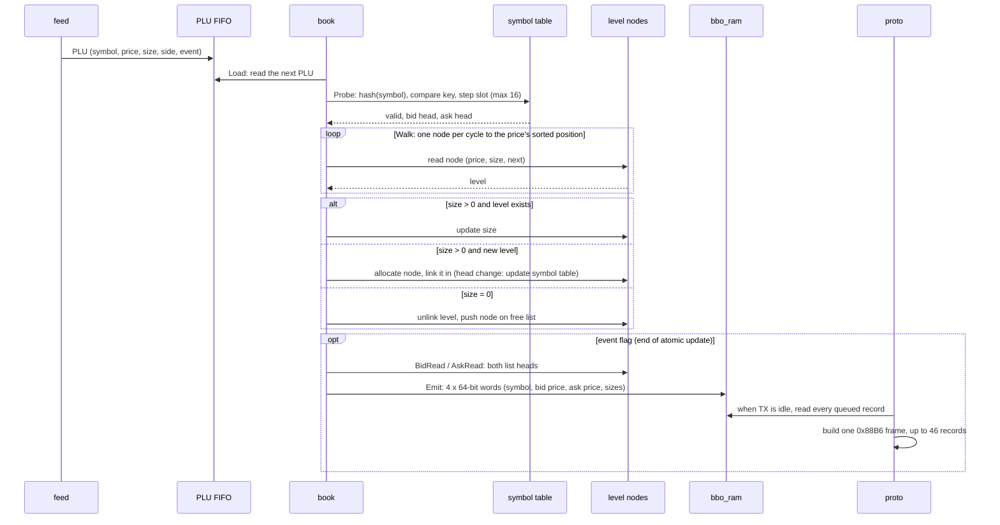

# Architecture: IEX feed in, best bid/offer out

How an IEX DEEP market-data packet becomes a best bid/offer (BBO) frame on
the Arty A7-100T. Everything inside `eth_core` is generated from the
`system!` declaration in `src/core.rs`: one 25 MHz clock (`eth_rx_clk`), five
units, and block RAMs between them. `rtl/arty_top.v` is the hand-written board
wrapper (clocks, resets, TX clock crossing, LEDs).

## Data path

```mermaid
flowchart TB
    host_in("Host: tcpreplay of iex_data_broadcast.pcap<br/>UDP multicast 233.215.21.4:10378")
    host_out("Host: scripts/iex_board_replay.py<br/>AF_PACKET socket, EtherType 0x88B6")

    subgraph board["Arty A7-100T"]
        phy_rx["DP83848 PHY<br/>MII RX: 4 bits per eth_rx_clk, 25 MHz"]
        phy_tx["DP83848 PHY<br/>MII TX, samples on eth_tx_clk"]

        subgraph core["eth_core (generated by bitlogic, eth_rx_clk domain)"]
            rx["rx src/rx.rs<br/>preamble/SFD search, nibbles to bytes<br/>CRC-32 check, FCS stripped<br/>bad FCS: dropped, fcs_errors++"]

            ring_p[("rx_ram + rx_meta<br/>8-frame ring, 2 KB slots")]
            ring_f[("feed_rx_ram + feed_rx_meta<br/>identical copy for the feed")]

            subgraph feedu["feed src/feed.rs: parse and filter"]
                f_filter{"byte 38:<br/>IPv4, UDP,<br/>dst 233.215.21.4:10378?"}
                f_hdr{"byte 81:<br/>IHL 0x45, no fragment,<br/>IP checksum, IEX-TP v1,<br/>protocol 0x8004,<br/>payload fits?"}
                f_seq["sequence check<br/>first_seq vs expected<br/>mismatch: seq_gaps++"]
                f_walk{"each message block:<br/>length 30 and type<br/>'8' buy / '5' sell?"}
                f_plu["extract PLU<br/>symbol, price, size,<br/>side, event flag"]
            end

            fifo[("PLU FIFO, 64 entries<br/>plu_symbol / plu_price / plu_misc<br/>full: feed stalls, nothing lost")]

            subgraph booku["book src/book.rs: order book and BBO"]
                b_hash["hash the 8-byte symbol<br/>to an 11-bit slot"]
                b_probe{"linear probe<br/>sym_key, up to 16 slots"}
                b_walk["walk the side's sorted list<br/>bids high to low, asks low to high<br/>one node per cycle"]
                b_upd["size > 0: insert or update level<br/>size = 0: unlink level, node to free list"]
                b_evt{"event flag set?<br/>end of atomic update"}
                b_bbo["read both list heads:<br/>best bid price/size,<br/>best ask price/size"]
            end

            symtab[("sym_key + sym_meta<br/>2,048 symbols:<br/>valid, bid head, ask head")]
            nodes[("node_price / node_size / node_next<br/>8,191 price levels + free_list")]
            bbo_ram[("bbo_ram<br/>256 records x 32 B")]

            subgraph protou["proto src/proto.rs: frame builder"]
                p_rx["ARP reply, ICMP echo reply<br/>other frames counted, feed frames skipped"]
                p_arb{"TX arbitration when idle:<br/>1 RX reply  2 gratuitous ARP<br/>3 beacon  4 BBO"}
                p_bbo["BBO frame: dst ff:ff:ff:ff:ff:ff, EtherType 0x88B6<br/>40 B header: count, first record seq,<br/>feed packets, gaps, malformed, book errors, RX drops<br/>+ up to 46 queued records, 32 B each"]
            end

            tx_ram[("tx_ram + tx_meta<br/>4 frames")]
            tx["tx src/tx.rs<br/>preamble + SFD, bytes to nibbles<br/>CRC-32 appended, 24-nibble gap"]
        end

        txfifo["TX clock crossing (rtl/arty_top.v)<br/>16-entry FIFO, Gray pointers<br/>eth_rx_clk to eth_tx_clk, IOB registers"]
    end

    host_in -->|"100 Mb/s Ethernet"| phy_rx --> rx
    rx -->|"ring full: rx_queue_drops++"| ring_p
    rx --> ring_f
    ring_p --> p_rx
    ring_f --> f_filter
    f_filter -->|no: skip frame| ring_f
    f_filter -->|yes| f_hdr
    f_hdr -->|"no: malformed++"| ring_f
    f_hdr -->|yes| f_seq --> f_walk
    f_walk -->|"no: skip block<br/>(trades, status, ...)"| f_walk
    f_walk -->|yes| f_plu --> fifo
    fifo --> b_hash --> b_probe
    b_probe <--> symtab
    b_probe -->|"table full: errors++"| b_evt
    b_probe --> b_walk
    b_walk <--> nodes
    b_walk -->|"64 hops: errors++"| b_evt
    b_walk --> b_upd --> b_evt
    b_upd <--> nodes
    b_upd -->|new head| symtab
    b_evt -->|no| fifo
    b_evt -->|yes| b_bbo --> bbo_ram
    bbo_ram --> p_arb
    p_rx --> p_arb
    p_arb --> p_bbo --> tx_ram
    p_arb -->|ARP, ICMP, beacon| tx_ram
    tx_ram --> tx --> txfifo --> phy_tx -->|"100 Mb/s Ethernet"| host_out
```

## One price level update through the book

Cycle counts are from `src/book.rs`; a PLU costs 9 + list depth cycles.

## BBO frame

| Bytes | Field |
|---|---|
| 0-13 | Ethernet: dst `ff:ff:ff:ff:ff:ff`, src `02:00:00:00:00:01`, EtherType `0x88B6` |
| 14 | version (1) |
| 15 | record count (1-46) |
| 16-19 | sequence number of the first record (records count from 0 after programming) |
| 20-39 | feed packets, sequence gaps, malformed segments, book errors, RX ring drops (u32 each) |
| 40 + 32k | record k: symbol (8 B), bid price (u64), ask price (u64), bid size (u32), ask size (u32) |

All multi-byte fields are little-endian, like IEX-TP. Prices are IEX's fixed
point (1/10,000 dollar); an empty side reads as price 0, size 0.
