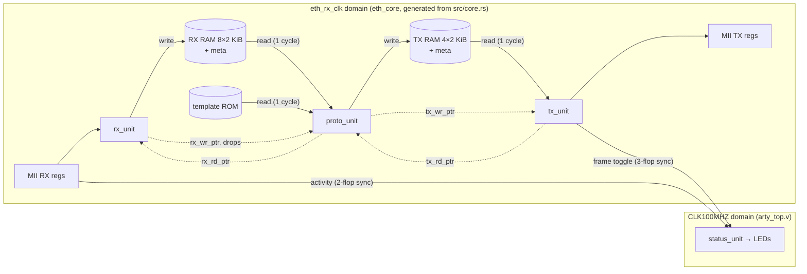

# bitlogic Ethernet endpoint

A reimplementation of the former `hls_ethernet/` Layer-2 endpoint (removed
2026-11-20; see git history) using
bitlogic (sibling checkout `../../bitlogic`). It has the same identity: MAC
`02:00:00:00:00:01` and IP `192.168.1.100`. It replies to ARP requests, sends a
gratuitous ARP every 5 s, and sends a diagnostics beacon (EtherType `0x88B5`)
every 1 s. Beyond the HLS design, it checks the FCS of every received frame
answers ICMP echo requests, so `ping 192.168.1.100` should work (verified
in simulation; not yet on the board), and learns ARP peers into a 16-entry cache. It uses the same pins and XDC (`constraints/arty_a7.xdc`).

```sh
python3 build.py build                          # generate RTL, then Vivado → bitlogic_ethernet/build/bitlogic_ethernet.bit
python3 build.py program --bitfile bitlogic_ethernet/build/bitlogic_ethernet.bit
cargo test --release --locked --manifest-path bitlogic_ethernet/Cargo.toml
```

## How it is split

All behavior lives in four `#[logic]` unit functions (pure, untimed
`state → next state`) and the `#[logic]` helpers they call (`src/ops.rs`).
`src/core.rs` declares how the three Ethernet units, four RAMs and the template
ROM connect, with `bitlogic::system!`. That one declaration generates both the
`eth_core` Verilog and the Rust cycle model the tests run. Clocks, resets and
clock-domain crossings are handwritten Verilog.

| Piece | Kind | File |
|---|---|---|
| MII RX assembly, preamble/SFD, FCS check and strip, RX ring producer | bitlogic | `src/rx.rs` |
| RX consumer, ARP and IPv4/ICMP parse and checksums, ARP peer cache, timers, TX frame preparation (ROM templates and echo-reply copy), counters | bitlogic | `src/proto.rs` |
| TX ring consumer, preamble/SFD, padding, CRC-32 FCS, IFG | bitlogic | `src/tx.rs` |
| LED activity/frame-count status (100 MHz domain) | bitlogic | `src/status.rs` |
| Shared helpers: hex digit, byte/nibble select, field shift-in, counters, CRC-32 byte, Internet checksum arithmetic | bitlogic (inlined at each call) | `src/ops.rs` |
| Beacon and ARP frame templates (512 × 9 ROM) | generated from Rust | `src/rom.rs` |
| Unit wiring, RAMs, MII boundary registers, unit wrappers (state register + step) | generated by `bitlogic::system!` (Verilog and Rust cycle model) | `src/core.rs` |
| PLL, PHY reference clock, resets, CDC | handwritten Verilog | `rtl/arty_top.v` |



Design rules that make the split work:

- **Each unit owns its state register.** The units are generated as
  `<unit>_unit_logic` (pure bitlogic) plus `<unit>_unit` (register +
  `s_<field>` outputs). Units only read each other's *registered* state
  (dotted lines). No combinational path crosses units; `system!` rejects any
  declaration that would create one.
- **Rings use pointers, not shared valid bits.** The producer owns `wr_ptr`,
  the consumer owns `rd_ptr`, and each pointer has one wrap bit. Each register
  has exactly one writer.
- **Memory latency is part of the state.** RAM and ROM reads take one cycle.
  Each unit drives its read address from its *next* state, so the read data
  during a cycle always belongs to the current state. Reads that might collide
  with a write are always discarded.
- **Helpers are `#[logic]` functions.** The units call `src/ops.rs` helpers
  (`crc32_byte`, `hex_digit`, `shift_in48`, …). bitlogic inlines each call, so
  helpers add no ports or registers; each call is its own copy of the logic.
- **Arrays and enums.** Unit phases are `#[derive(LogicValue)]` enums matched
  with `match`; the byte/nibble selectors in `ops.rs`, the beacon counter
  selection use bitlogic arrays (`t.at(i)`, `t.set(i, v)`). The peer cache is
  one line, `fixed_map!(pub mod peer_cache: Bits<32> => Bits<48>, capacity = 16)`,
  which generates the cache type and its lookup/update functions; the protocol
  unit looks the sender up once and passes the result to `peer_cache::store`.
- **Frame templates live in a ROM by choice.** The 185-byte beacon and 42-byte
  ARP frames are constant except for a few fields. A 512 × 9 ROM (half a BRAM)
  plus a substitution step is cheaper than building each byte from the index in
  logic, so the ROM stays even though helpers are now available.
- **Config is an input.** MAC, IP and the timer intervals enter `proto_step` as
  inputs, tied to `eth_core` parameters. Tests use short intervals.

## Behavior relative to the former HLS design

ARP and beacon behavior match at the frame level. Cycle timing differs, because
HLS scheduled its own pipeline and this design adds a register on each MII
boundary and uses explicit memory reads.

- RX: frames with `rxerr`, or shorter than header + FCS, are not queued. Unlike
  HLS, the FCS is checked: the CRC-32 register runs over the whole frame
  including the FCS and must end at the residue `0xDEBB20E3`. Failing frames
  are not queued and are counted in `FCS`. Bodies over 1514 bytes are marked
  truncated and counted as protocol drops.
- ICMP echo (new): a request is answered when it is unicast to our MAC and IP,
  IPv4 with no options (IHL 5) and not fragmented, protocol 1, type 8 code 0,
  the datagram fits in the frame, and both the IPv4 header checksum and the
  ICMP checksum verify. The reply copies the request from the RX slot to a TX
  slot, swapping addresses, setting TTL 64 and type 0, and updating both
  checksums incrementally (RFC 1624). Everything else (TOS, ID, flags,
  identifier, sequence, data) is copied. Ethernet padding is not echoed.
  Requests up to 1472 data bytes (a 1500-byte datagram) are answered.
- ARP peer cache (new): 16 entries of `{IP, MAC}` in registers, maintained by
  the RFC 826 merge rules. A well-formed ARP request or reply (opcode 1 or 2,
  to our MAC or broadcast) whose sender IP is cached refreshes that entry's MAC;
  one whose target IP is ours adds its sender to the first vacant slot, or
  replaces slots round-robin (oldest addition first) when the cache is full. Sender IP 0.0.0.0 (an RFC 5227 probe) is never
  learned. The beacon's `PEERS` field reports the number of valid entries.
  Nothing transmits from the cache yet; it is the lookup a UDP or other
  host-initiated service would use.
- Protocol: `RX`, `RXQ`, `TXD`, `ARP` and `UP` have the HLS semantics. `RXP`
  counts frames that are neither a valid ARP request, nor a valid echo
  request, nor used by the peer cache (so an ARP request for another host from
  a cached sender refreshes the cache and is not a drop).
  `ICMP` counts valid echo requests (a full TX ring drops the reply and
  increments `TXD`, as for ARP). The handler now reads every received byte, so
  timer ticks stay pending until IDLE serves them instead of being lost while
  it is busy. A gratuitous ARP goes before a beacon that is due at the same
  time; the HLS design drops that beacon.
- TX: frames are padded to 60 bytes, the FCS is sent LSB first, and the IFG is
  24 nibble cycles. The beacon text matches the HLS beacon up to `UP=`, then
  appends ` FCS=xxxxxxxx ICMP=xxxxxxxx PEERS=xxxxxxxx` (185-byte frame body).

Changes from the HLS top level:

- The Ethernet domain gets a proper reset synchronizer: asynchronous assert on
  PLL unlock, synchronous release on `eth_rx_clk`.
- The activity signal is registered in its source domain before it crosses.

## Verification

`cargo test --release --locked` runs:

| Test | Evidence |
|---|---|
| `tests/steps.rs` | Native Rust vs bitlogic IR on 20,000 random inputs per function, including unreachable states; LED sequence; `ops.rs` helpers vs independent definitions (hex, byte/nibble select, CRC-32 vs the MSB-first reference, ones'-complement addition, RFC 1624 update vs recomputing, the RX CRC residue) |
| `tests/endpoint.rs` | Generated cycle model of `eth_core`: ARP reply bytes, ignored frames, beacon counters/text, gratuitous ARP, gratuitous ARP then beacon on coinciding ticks, IFG, maximum/oversized frames, TX ring overflow; the IR backend matches native cycle for cycle on ARP, ICMP and bad-FCS traffic |
| `tests/icmp.rs` | Byte-exact echo replies for 0, 1, 17, 56 and 1472 data bytes with nonzero sender padding; 13 invalid variants (wrong IP/MAC, broadcast, bad IPv4 or ICMP checksum, fragments, options, other protocol, echo reply, nonzero code, bad lengths) are counted, not answered; bad-FCS frames are dropped and counted; a beacon tick during a long echo is not lost; 40 random frames (valid, invalid, bad FCS, ARP) match the oracle |
| `tests/peers.rs` | Peer cache contents compared after every frame with an independent RFC 826 model over 400 random ARP frames (24 sender IPs including 0.0.0.0, requests/replies/bad opcodes, ours/other/broadcast destinations, bad hardware length), so the cache fills and replaces entries; ARP replies, `RXP` and the beacon's `PEERS` on the wire; a directed refresh/probe/malformed sequence |
| `tests/hdl.rs` | Generated `eth_core` Verilog in Vivado xsim matches the generated Rust cycle model on all 30,000 cycles of a mixed scenario including echo requests, a bad FCS and 21 peers (the cache fills and wraps) |
| `tests/top.rs` | Board-level xsim of `arty_top` with Xilinx PLL/BUFG/ODDR models and an asynchronous PHY clock (see below) |

Expected frames, the CRC (MSB-first form), MII encoding/decoding, the RFC 1071
Internet checksum and ICMP request/reply builders live in `tests/common`,
written independently of the design. Expected echo replies recompute both
checksums from scratch rather than updating them. Disabling pending ticks, the
ICMP checksum update, FCS enforcement or ICMP checksum verification each makes
at least one test fail, as does each of seven peer-cache mutations (learning
0.0.0.0, adding without being the target, no refresh, refreshing the wrong
slot, a stuck insertion slot, a miscount, and counting learned frames as
drops; applied to the earlier hand-written cache). The generated
`fixed_map!` code has its own mutation checks in bitlogic's
`tests/collections.rs`. The xsim tests need Vivado
(`XILINX_ROOT`, default `~/Xilinx/2025.2`). Set `BITLOGIC_ETHERNET_SKIP_HDL=1`
to skip them explicitly.

Until 2026-11-19 the core's wiring was hand-written twice: `rtl/eth_core.v` and
a Rust cycle model in `src/sim.rs`. Before those were replaced by the
`system!` declaration, the generated and hand-written cycle models agreed on
every output and every unit state over 526,184 cycles of random ARP, ICMP,
IPv4, beacon and corrupted-FCS traffic with RX-ring overflow bursts, and the
two Verilog cores produced identical pins over 63,400 cycles in xsim.

### Board-level simulation

`sim/tb_arty_top.v` simulates the whole FPGA top: Xilinx `unisims_ver` models of
the PLL, BUFG and ODDR, the reset synchronizer, both clock-domain crossings and
the LED unit. The PHY RX clock starts only after `eth_rstn` releases, with an
arbitrary phase and a 100 ppm offset from the 100 MHz board clock. The timers
are shortened through `arty_top` parameters (beacon 3,000 cycles, gratuitous
ARP 7,000, LED holdoff 200). The parameter defaults are the board values.

`tests/top.rs` runs 10,000 PHY cycles (about 0.4 ms of simulated time) and checks:

- the PLL locks (about 0.57 µs), `eth_rstn` releases, and `eth_ref_clk` is 40.000 ns;
- the TX pins match the Rust cycle model on every cycle after reset;
- the frames are an ARP reply, an ICMP echo reply, two beacons, a gratuitous ARP
  and a third beacon, with correct counters and FCS; a request with a corrupted
  FCS is counted and not answered;
- `led[3:1]` counts each of the 6 frames once through the toggle synchronizer,
  and `led[0]` lights on activity and clears after the holdoff.

Breaking the toggle synchronizer's edge detect makes this test fail.

To inspect waveforms after `cargo test --release --test top`:

```sh
cd bitlogic_ethernet/target/tmp/xsim_arty_top
~/Xilinx/2025.2/Vivado/bin/xsim tb_arty_top_sim -gui
```

## Implementation results

Vivado 2025.2, `xc7a100ticsg324-1L`, measured 2026-11-19 with the core generated by `system!`:

| Metric | bitlogic (ARP + beacon + FCS check + ICMP echo + peer cache) | HLS design (ARP + beacon) |
|---|---|---|
| Slice LUTs | 1,395 | 2,228 |
| Slice registers | 2,047 | 1,334 |
| Block RAM tiles | 6.5 | — |
| Setup WNS / hold WHS | +4.799 ns / +0.114 ns, 0 failing endpoints | — |
| `eth_rx_clk` (40 ns) setup slack | +26.521 ns | — |
| `report_cdc` | 2 endpoints, both Safe (ASYNC_REG synchronizers) | — |

History of the bitlogic design: 889 LUTs / 1,050 registers (ARP + beacon),
then 1,304 / 1,510 with FCS checking and ICMP echo, then 1,413 / 2,051 with a
hand-written peer cache. Generating the cache with `fixed_map!` (which adds a
vacant-slot search) gives 1,396 / 2,047. Generating the core's wiring with
`system!` leaves registers and BRAM unchanged and gives 1,395 LUTs; the
timing differences from the hand-wired build (WNS +4.879 ns, `eth_rx_clk`
+25.823 ns) are placement variation. The cache adds about 537
registers, less than its 1,296 state bits, because nothing reads the cached
MACs yet and synthesis can remove those 768 flops (inferred from the counts, not confirmed in the synthesis log). The
overall WNS is in the 100 MHz LED domain.

No critical warnings were reported. These are post-route static results, not
board validation.

## Limits

- Simulation does not model PHY timing, MII pad delays or a real link.
  Board-level validation still uses the existing `tests/hw` suite. Run
  `python3 build.py test --hardware`
  after programming.
- As in the HLS design, TX is clocked by `eth_rx_clk`, not the PHY's
  `eth_tx_clk`, and the XDC has no MII input/output delay constraints.
- RX ring overflow is implemented but not exercised. The protocol unit
  processes frames faster than they arrive (one cycle per byte to parse, plus
  one per byte to copy an echo request, against two cycles per byte on the
  wire), so the ring cannot fill in these tests.
- The peer cache is observable only through `PEERS`; no feature transmits to
  a cached peer yet, and entries never expire.
- ICMP echo is the only IPv4 service. There is no IPv4 option handling,
  fragment reassembly, broadcast ping or ICMP error generation. The
  `tests/hw/test_icmp.py` board test exists but has not been run.
- The timer intervals assume a 100 Mb/s link. At 10 Mb/s the MII clock is
  2.5 MHz, so beacons slow by 10× (same as HLS).
