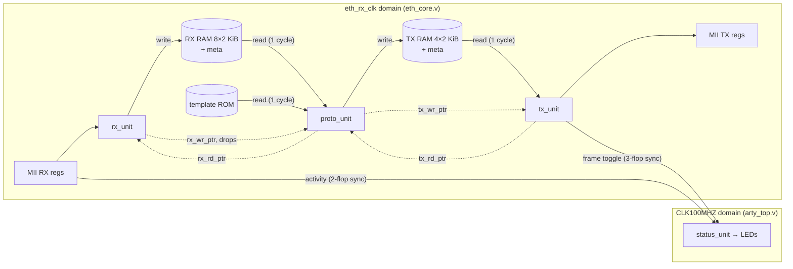

# bitlogic Ethernet endpoint

A reimplementation of the `hls_ethernet/` Layer-2 endpoint using
bitlogic (sibling checkout `../../bitlogic`). It has the same identity and behavior: MAC
`02:00:00:00:00:01` and IP `192.168.1.100`. It replies to ARP requests, sends a
gratuitous ARP every 5 s, and sends a diagnostics beacon (EtherType `0x88B5`)
every 1 s. It uses the same pins and XDC (`constraints/arty_a7.xdc`).

```sh
python3 build.py build --design bitlogic        # generate RTL, then Vivado → bitlogic_ethernet/build/bitlogic_ethernet.bit
python3 build.py program --bitfile bitlogic_ethernet/build/bitlogic_ethernet.bit
cargo test --release --locked --manifest-path bitlogic_ethernet/Cargo.toml
```

## How it is split

bitlogic only expresses pure, untimed functions `state → next state`. All
behavior lives in four `#[logic]` unit functions and the `#[logic]` helpers they call (`src/ops.rs`). Everything with time, storage or
physical meaning is Verilog.

| Piece | Kind | File |
|---|---|---|
| MII RX assembly, preamble/SFD, FCS strip, RX ring producer | bitlogic | `src/rx.rs` |
| RX consumer, ARP parse/decision, timers, TX frame preparation, counters | bitlogic | `src/proto.rs` |
| TX ring consumer, preamble/SFD, padding, CRC-32 FCS, IFG | bitlogic | `src/tx.rs` |
| LED activity/frame-count status (100 MHz domain) | bitlogic | `src/status.rs` |
| Shared helpers: hex digit, byte/nibble select, field shift-in, counters, CRC-32 byte | bitlogic (inlined at each call) | `src/ops.rs` |
| Beacon and ARP frame templates (512 × 9 ROM) | generated from Rust | `src/rom.rs` |
| Registered unit wrappers (state register + step) | generated from Rust | `src/hdl.rs` |
| RAMs, MII boundary registers, unit wiring | handwritten Verilog | `rtl/eth_core.v`, `rtl/sdp_ram.v` |
| PLL, PHY reference clock, resets, CDC | handwritten Verilog | `rtl/arty_top.v` |



Design rules that make the split work:

- **Each unit owns its state register.** The units are generated as
  `<unit>_logic` (pure bitlogic) plus `<unit>` (register + `s_<field>` outputs).
  Units only read each other's *registered* state (dotted lines). No
  combinational path crosses units.
- **Rings use pointers, not shared valid bits.** The producer owns `wr_ptr`,
  the consumer owns `rd_ptr`, and each pointer has one wrap bit. Each register
  has exactly one writer.
- **Memory latency is part of the state.** RAM and ROM reads take one cycle.
  Each unit drives its read address from its *next* state, so the read data
  during a cycle always belongs to the current state. Reads that might collide
  with a write are always discarded.
- **Helpers are `#[logic]` functions.** The units call `src/ops.rs` helpers
  (`crc32_byte`, `hex_digit`, `shift_in48`, …). bitlogic inlines each call, so
  helpers add no ports or registers; each call is its own copy of the logic.
- **Frame templates live in a ROM by choice.** The 143-byte beacon and 42-byte
  ARP frames are constant except for a few fields. A 512 × 9 ROM (half a BRAM)
  plus a substitution step is cheaper than building each byte from the index in
  logic, so the ROM stays even though helpers are now available.
- **Config is an input.** MAC, IP and the timer intervals enter `proto_step` as
  inputs, tied to `eth_core` parameters. Tests use short intervals.

## Behavior relative to the HLS design

The behavior matches at the frame level. Cycle timing differs, because HLS
scheduled its own pipeline and this design adds a register on each MII boundary
and uses explicit memory reads.

- RX: frames with `rxerr`, or shorter than header + FCS, are not queued. FCS is
  not checked on receive (same as HLS). Bodies over 1514 bytes are marked
  truncated and counted as protocol drops.
- Protocol: the counters (`RX`, `RXQ`, `RXP`, `TXD`, `ARP`, `UP`) have the same
  semantics. A full TX ring drops the reply and increments `TXD`. Timer ticks
  that arrive while the handler is busy are lost. A gratuitous-ARP tick wins
  over a simultaneous beacon tick.
- TX: frames are padded to 60 bytes, the FCS is sent LSB first, and the IFG is
  24 nibble cycles. The beacon text is byte-identical to the HLS beacon.

Changes from the HLS top level:

- The Ethernet domain gets a proper reset synchronizer: asynchronous assert on
  PLL unlock, synchronous release on `eth_rx_clk`.
- The activity signal is registered in its source domain before it crosses.

## Verification

`cargo test --release --locked` runs:

| Test | Evidence |
|---|---|
| `tests/steps.rs` | Native Rust vs bitlogic IR on 20,000 random inputs per function, including unreachable states; LED sequence; `ops.rs` helpers vs independent definitions (hex, byte/nibble select, CRC-32 vs the MSB-first reference) |
| `tests/endpoint.rs` | Cycle model of `eth_core.v`: ARP reply bytes, ignored frames, beacon counters/text, gratuitous ARP, tick priority, IFG, maximum/oversized frames, TX ring overflow; the IR backend matches native cycle for cycle |
| `tests/hdl.rs` | Generated + handwritten Verilog in Vivado xsim matches the Rust cycle model on all 20,000 cycles of a mixed scenario |

Expected frames, the CRC (MSB-first form) and MII encoding/decoding live in
`tests/common`, written independently of the design. The HDL test needs Vivado
(`XILINX_ROOT`, default `~/Xilinx/2025.2`). Set `BITLOGIC_ETHERNET_SKIP_HDL=1`
to skip it explicitly.

## Implementation results

Vivado 2025.2, `xc7a100ticsg324-1L`, measured 2026-11-18:

| Metric | bitlogic | HLS design (same flow) |
|---|---|---|
| Slice LUTs | 889 | 2,228 |
| Slice registers | 1,050 | 1,334 |
| Block RAM tiles | 6.5 | — |
| Setup WNS / hold WHS | +5.245 ns / +0.074 ns, 0 failing endpoints | — |
| `report_cdc` | 2 endpoints, both Safe (ASYNC_REG synchronizers) | — |

No critical warnings were reported. These are post-route static results, not
board validation.

## Limits

- Board-level validation still uses the existing `tests/hw` suite. Run
  `python3 build.py test --hardware --bitfile bitlogic_ethernet/build/bitlogic_ethernet.bit`
  after programming.
- As in the HLS design, TX is clocked by `eth_rx_clk`, not the PHY's
  `eth_tx_clk`, and the XDC has no MII input/output delay constraints.
- RX ring overflow is implemented but not exercised. The protocol unit
  processes frames faster than the minimum frame interval, so the ring cannot
  fill in these tests.
- The timer intervals assume a 100 Mb/s link. At 10 Mb/s the MII clock is
  2.5 MHz, so beacons slow by 10× (same as HLS).
