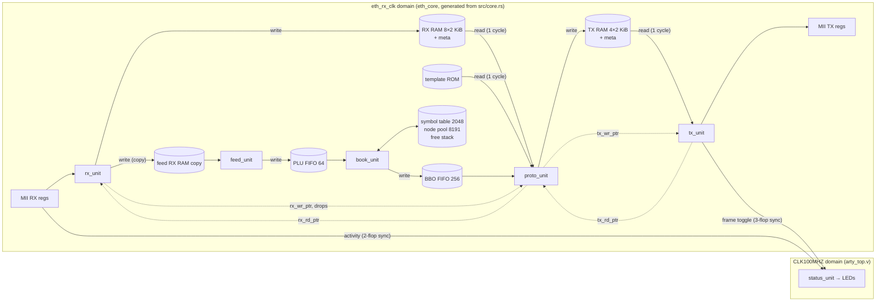

# bitlogic Ethernet endpoint

A reimplementation of the former `hls_ethernet/` Layer-2 endpoint (removed
2026-11-20; see git history) using
bitlogic (sibling checkout `../bitlogic` of this repository). It has the same identity: MAC
`02:00:00:00:00:01` and IP `192.168.1.100`. It replies to ARP requests, sends a
gratuitous ARP every 5 s, and sends a diagnostics beacon (EtherType `0x88B5`)
every 1 s. Beyond the HLS design, it checks the FCS of every received frame
answers ICMP echo requests, so `ping 192.168.1.100` should work (verified
in simulation and on the board), and learns ARP peers into a 16-entry cache. It uses the same pins and XDC (`constraints/arty_a7.xdc`).

It is also an **IEX DEEP market-data feed handler** (added 2026-11-20): it
parses IEX-TP segments on UDP multicast `233.215.21.4:10378`, keeps a full
price-level order book per symbol in block RAM, and sends the best bid and
offer of a symbol each time an atomic book update completes. See
[IEX DEEP feed handler](#iex-deep-feed-handler). This too is verified in
simulation only.

From the repository root (paths below are relative to this directory,
`projects/ethernet/`, unless they start with `build/`):

```sh
python3 build.py build ethernet       # generate RTL, then Vivado → build/ethernet/ethernet.bit
python3 build.py program ethernet
cargo test --release --locked -p bitlogic_ethernet
```

## How it is split

All behavior lives in four `#[logic]` unit functions (pure, untimed
`state → next state`) and the `#[logic]` helpers they call (`src/ops.rs`).
`src/core.rs` declares how the three Ethernet units, four RAMs and the template
ROM connect, with `bitlogic::system!`. That one declaration generates both the
`eth_core` Verilog and the Rust cycle model the tests run. Clocks, resets and
clock-domain crossings are handwritten Verilog.

| Piece | Kind | File |
|---|---|---|
| MII RX assembly, preamble/SFD, FCS check and strip, RX ring producer | bitlogic | `src/rx.rs` |
| RX consumer, ARP and IPv4/ICMP parse and checksums, ARP peer cache, timers, TX frame preparation (ROM templates and echo-reply copy), counters | bitlogic | `src/proto.rs` |
| TX ring consumer, preamble/SFD, padding, CRC-32 FCS, IFG | bitlogic | `src/tx.rs` |
| IEX feed: Ethernet/IPv4/UDP/IEX-TP header checks, message-block walk, sequence tracking, PLU FIFO producer | bitlogic | `src/feed.rs` |
| Order book: symbol hash table, sorted price-level lists with node pool and free stack, BBO FIFO producer | bitlogic | `src/book.rs` |
| LED activity/frame-count status (100 MHz domain) | bitlogic | `src/status.rs` |
| Shared helpers: hex digit, byte/nibble select, field shift-in, counters, CRC-32 byte, Internet checksum arithmetic | bitlogic (inlined at each call) | `src/ops.rs` |
| Beacon and ARP frame templates (512 × 9 ROM) | generated from Rust | `src/rom.rs` |
| Unit wiring, RAMs, MII boundary registers, unit wrappers (state register + step) | generated by `bitlogic::system!` (Verilog and Rust cycle model) | `src/core.rs` |
| PLL, PHY reference clock, resets, CDC | handwritten Verilog | `rtl/arty_top.v` |



Design rules that make the split work:

- **Each unit owns its state register.** The units are generated as
  `<unit>_unit_logic` (pure bitlogic) plus `<unit>_unit` (register +
  `s_<field>` outputs). Units only read each other's *registered* state
  (dotted lines). No combinational path crosses units; `system!` rejects any
  declaration that would create one.
- **Rings use pointers, not shared valid bits.** The producer owns `wr_ptr`,
  the consumer owns `rd_ptr`, and each pointer has one wrap bit. Each register
  has exactly one writer.
- **Memory latency is part of the state.** RAM and ROM reads take one cycle.
  Each unit drives its read address from its *next* state, so the read data
  during a cycle always belongs to the current state. Reads that might collide
  with a write are always discarded.
- **Helpers are `#[logic]` functions.** The units call `src/ops.rs` helpers
  (`crc32_byte`, `hex_digit`, `shift_in48`, …). bitlogic inlines each call, so
  helpers add no ports or registers; each call is its own copy of the logic.
- **Arrays and enums.** Unit phases are `#[derive(LogicValue)]` enums matched
  with `match`; the byte/nibble selectors in `ops.rs`, the beacon counter
  selection use bitlogic arrays (`t.at(i)`, `t.set(i, v)`). The peer cache is
  one line, `fixed_map!(pub mod peer_cache: Bits<32> => Bits<48>, capacity = 16)`,
  which generates the cache type and its lookup/update functions; the protocol
  unit looks the sender up once and passes the result to `peer_cache::store`.
- **Frame templates live in a ROM by choice.** The 185-byte beacon and 42-byte
  ARP frames are constant except for a few fields. A 512 × 9 ROM (half a BRAM)
  plus a substitution step is cheaper than building each byte from the index in
  logic, so the ROM stays even though helpers are now available.
- **Config is an input.** MAC, IP and the timer intervals enter `proto_step` as
  inputs, tied to `eth_core` parameters. Tests use short intervals.

## Behavior relative to the former HLS design

ARP and beacon behavior match at the frame level. Cycle timing differs, because
HLS scheduled its own pipeline and this design adds a register on each MII
boundary and uses explicit memory reads.

- RX: frames with `rxerr`, or shorter than header + FCS, are not queued. Unlike
  HLS, the FCS is checked: the CRC-32 register runs over the whole frame
  including the FCS and must end at the residue `0xDEBB20E3`. Failing frames
  are not queued and are counted in `FCS`. Bodies over 1514 bytes are marked
  truncated and counted as protocol drops.
- ICMP echo (new): a request is answered when it is unicast to our MAC and IP,
  IPv4 with no options (IHL 5) and not fragmented, protocol 1, type 8 code 0,
  the datagram fits in the frame, and both the IPv4 header checksum and the
  ICMP checksum verify. The reply copies the request from the RX slot to a TX
  slot, swapping addresses, setting TTL 64 and type 0, and updating both
  checksums incrementally (RFC 1624). Everything else (TOS, ID, flags,
  identifier, sequence, data) is copied. Ethernet padding is not echoed.
  Requests up to 1472 data bytes (a 1500-byte datagram) are answered.
- ARP peer cache (new): 16 entries of `{IP, MAC}` in registers, maintained by
  the RFC 826 merge rules. A well-formed ARP request or reply (opcode 1 or 2,
  to our MAC or broadcast) whose sender IP is cached refreshes that entry's MAC;
  one whose target IP is ours adds its sender to the first vacant slot, or
  replaces slots round-robin (oldest addition first) when the cache is full. Sender IP 0.0.0.0 (an RFC 5227 probe) is never
  learned. The beacon's `PEERS` field reports the number of valid entries.
  Nothing transmits from the cache yet; it is the lookup a UDP or other
  host-initiated service would use.
- Protocol: `RX`, `RXQ`, `TXD`, `ARP` and `UP` have the HLS semantics. `RXP`
  counts frames that are neither a valid ARP request, nor a valid echo
  request, nor used by the peer cache (so an ARP request for another host from
  a cached sender refreshes the cache and is not a drop).
  `ICMP` counts valid echo requests (a full TX ring drops the reply and
  increments `TXD`, as for ARP). The handler now reads every received byte, so
  timer ticks stay pending until IDLE serves them instead of being lost while
  it is busy. A gratuitous ARP goes before a beacon that is due at the same
  time; the HLS design drops that beacon.
- TX: frames are padded to 60 bytes, the FCS is sent LSB first, and the IFG is
  24 nibble cycles. The beacon text matches the HLS beacon up to `UP=`, then
  appends ` FCS=xxxxxxxx ICMP=xxxxxxxx PEERS=xxxxxxxx` (185-byte frame body).

Changes from the HLS top level:

- The Ethernet domain gets a proper reset synchronizer: asynchronous assert on
  PLL unlock, synchronous release on `eth_rx_clk`.
- The activity signal is registered in its source domain before it crosses.

## Verification

`cargo test --release --locked -p bitlogic_ethernet` runs:

| Test | Evidence |
|---|---|
| `tests/steps.rs` | Native Rust vs bitlogic IR on 20,000 random inputs per function, including unreachable states; LED sequence; `ops.rs` helpers vs independent definitions (hex, byte/nibble select, CRC-32 vs the MSB-first reference, ones'-complement addition, RFC 1624 update vs recomputing, the RX CRC residue) |
| `tests/endpoint.rs` | Generated cycle model of `eth_core`: ARP reply bytes, ignored frames, beacon counters/text, gratuitous ARP, gratuitous ARP then beacon on coinciding ticks, IFG, maximum/oversized frames, TX ring overflow; the IR backend matches native cycle for cycle on ARP, ICMP and bad-FCS traffic |
| `tests/icmp.rs` | Byte-exact echo replies for 0, 1, 17, 56 and 1472 data bytes with nonzero sender padding; 13 invalid variants (wrong IP/MAC, broadcast, bad IPv4 or ICMP checksum, fragments, options, other protocol, echo reply, nonzero code, bad lengths) are counted, not answered; bad-FCS frames are dropped and counted; a beacon tick during a long echo is not lost; 40 random frames (valid, invalid, bad FCS, ARP) match the oracle |
| `tests/peers.rs` | Peer cache contents compared after every frame with an independent RFC 826 model over 400 random ARP frames (24 sender IPs including 0.0.0.0, requests/replies/bad opcodes, ours/other/broadcast destinations, bad hardware length), so the cache fills and replaces entries; ARP replies, `RXP` and the beacon's `PEERS` on the wire; a directed refresh/probe/malformed sequence |
| `tests/feed.rs` | IEX feed handler, cycle model against an independent reference book (ordered maps per symbol and side, `tests/common/iex.rs`): all 100,000 packets of `iex_data_broadcast.pcap` at line rate give the same 99,474 BBO records with no drops, gaps or errors; hand-checked sorted levels, updates, deletes (present and absent) and node reuse; the DEEP specification's two-PLU atomic example; 4,000 random PLUs with interleaved trades; foreign group/port, bad IPv4 checksum, wrong protocol/version, payload overrun, count mismatch and sequence gaps counted; ARP and ping answered between feed frames; the probe limit (17 colliding symbols), the 64-node walk limit, node-pool exhaustion and reuse; 300 maximum-size segments at the minimum gap; a saturated PLU FIFO stalls the feed without loss; IR backend equals native cycle for cycle |
| `tests/hdl.rs` | Generated `eth_core` Verilog in Vivado xsim matches the generated Rust cycle model on all 36,000 cycles of a mixed scenario including echo requests, a bad FCS, 21 peers (the cache fills and wraps) and 12 IEX segments that produce BBO frames |
| `tests/top.rs` | Board-level xsim of `arty_top` with Xilinx PLL/BUFG/ODDR models and an asynchronous PHY clock (see below) |

Expected frames, the CRC (MSB-first form), MII encoding/decoding, the RFC 1071
Internet checksum and ICMP request/reply builders live in `tests/common`,
written independently of the design. Expected echo replies recompute both
checksums from scratch rather than updating them. Disabling pending ticks, the
ICMP checksum update, FCS enforcement or ICMP checksum verification each makes
at least one test fail, as does each of seven peer-cache mutations (learning
0.0.0.0, adding without being the target, no refresh, refreshing the wrong
slot, a stuck insertion slot, a miscount, and counting learned frames as
drops; applied to the earlier hand-written cache). The generated
`fixed_map!` code has its own mutation checks in bitlogic's
`tests/collections.rs`. The xsim tests need Vivado
(`XILINX_ROOT`, default `~/Xilinx/2025.2`). Set `BITLOGIC_ETHERNET_SKIP_HDL=1`
to skip them explicitly.

Until 2026-11-19 the core's wiring was hand-written twice: `rtl/eth_core.v` and
a Rust cycle model in `src/sim.rs`. Before those were replaced by the
`system!` declaration, the generated and hand-written cycle models agreed on
every output and every unit state over 526,184 cycles of random ARP, ICMP,
IPv4, beacon and corrupted-FCS traffic with RX-ring overflow bursts, and the
two Verilog cores produced identical pins over 63,400 cycles in xsim.

### Board-level simulation

`sim/tb_arty_top.v` simulates the whole FPGA top: Xilinx `unisims_ver` models of
the PLL, BUFG and ODDR, the reset synchronizer, both clock-domain crossings and
the LED unit. The PHY RX clock starts only after `eth_rstn` releases, with an
arbitrary phase and a 100 ppm offset from the 100 MHz board clock. The timers
are shortened through `arty_top` parameters (beacon 3,000 cycles, gratuitous
ARP 7,000, LED holdoff 200). The parameter defaults are the board values.

`tests/top.rs` runs 10,000 PHY cycles (about 0.4 ms of simulated time) and checks:

- the PLL locks (about 0.57 µs), `eth_rstn` releases, and `eth_ref_clk` is 40.000 ns;
- the TX pins match the Rust cycle model on every cycle after reset;
- the frames are an ARP reply, an ICMP echo reply, two beacons, a gratuitous ARP
  and a third beacon, with correct counters and FCS; a request with a corrupted
  FCS is counted and not answered;
- `led[3:1]` counts each of the 6 frames once through the toggle synchronizer,
  and `led[0]` lights on activity and clears after the holdoff.

Breaking the toggle synchronizer's edge detect makes this test fail.

To inspect waveforms after `cargo test --release -p bitlogic_ethernet --test top`
(from the repository root, where the workspace `target/` is):

```sh
cd target/tmp/xsim_arty_top
~/Xilinx/2025.2/Vivado/bin/xsim tb_arty_top_sim -gui
```

## IEX DEEP feed handler

Diagrams of the data path, from feed packet to BBO frame: [ARCHITECTURE.md](ARCHITECTURE.md).

```text
RX ring copy -> feed_unit -> PLU FIFO (64) -> book_unit -> BBO FIFO (256) -> proto_unit -> TX ring
```

**Feed (`src/feed.rs`).** The RX unit writes every frame into two RAM copies;
the feed unit owns the second copy and its own ring pointer, and the ring is
full when either consumer is 8 frames behind. A frame is released at byte 38
unless it is IPv4/UDP to the feed group and port. At byte 81 the rest is
checked: no IPv4 options or fragments, the IPv4 header checksum, IEX-TP
version 1, message protocol `0x8004` (DEEP), and the payload inside the
frame. The walk then reads each message block's length and type (3 cycles)
and jumps over anything but a 30-byte Price Level Update (`8` buy, `5` sell);
a PLU reads its flags, skips the timestamp and reads symbol, size and price
(24 cycles). Each PLU is pushed into the PLU FIFO; a full FIFO stalls the
walk. A segment whose first sequence number is not the one expected counts
in `seq_gaps`; header failures, overruns and count mismatches count in
`malformed`. The feed reads at most one byte per cycle while the wire
delivers one every two, so it always keeps up.

**Book (`src/book.rs`).** A 2,048-slot symbol table (open addressing, XOR-fold
hash, at most 16 probes) holds each symbol's bid and offer list heads. Price
levels are nodes in a shared 8,191-node pool, linked in one sorted list per
symbol and side (bids descending, offers ascending), so a list head is the
best level. A PLU walks its list one node per cycle to its price, then
updates the size, deletes the level (size 0) or inserts a node; deleted nodes
go onto a free stack and are reused first. Deleting an absent level is a
no-op, so a feed joined mid-session works. A PLU with Event Flags bit 0 set
ends an atomic event; the book then reads both heads and writes a BBO record.
A PLU costs `9 + depth walked` cycles. Failures (table full, a walk past 64
nodes, pool exhausted) drop the PLU and count in `errors`. The phase is an
enum with fields (2026-11-21): data that only one phase uses travels in its
variant (`Probe { probes }`, `Walk(Cursor)`, `Link { after, node }`,
`AskRead { bid }`, `Emit { bid, ask, word }`), so it cannot be read in the
wrong phase. bitlogic stores the enum as a tagged union: the variants share
one 194-bit payload (the size of `Emit`), and `bid`, the first field of both
`AskRead` and `Emit`, sits at the same bits in both.

**BBO frames.** The protocol unit drains the BBO FIFO when it is otherwise
idle and the TX ring has room, up to 46 records per frame, so records batch
naturally under load. Frame body (multi-byte fields little-endian, as in
IEX):

| Offset | Size | Field |
|---|---|---|
| 0 | 6 | destination MAC (`bbo_mac` parameter, default broadcast) |
| 6 | 6 | source MAC (`02:00:00:00:00:01`) |
| 12 | 2 | EtherType `0x88B6` |
| 14 | 1 | version 1 |
| 15 | 1 | record count N (1..=46) |
| 16 | 4 | sequence number of the first record (records sent before it) |
| 20 | 4 | IEX-TP segments accepted |
| 24 | 4 | sequence gaps |
| 28 | 4 | malformed segments |
| 32 | 4 | book errors |
| 36 | 4 | RX ring drops |
| 40 + 32k | 8 | record k: symbol (8 ASCII bytes, space padded) |
| 48 + 32k | 8 | bid price (IEX price, 4 implied decimals; 0 if no bid) |
| 56 + 32k | 8 | offer price (0 if no offer) |
| 64 + 32k | 4 | bid size |
| 68 + 32k | 4 | offer size |

Feed frames to the group and port are not counted as protocol drops
(`RXP`), and the protocol unit stops parsing other non-ICMP IPv4 frames at
byte 42.

### Measured in the cycle model

`cargo run --release -p bitlogic_ethernet --example feed_bench` replays the sample capture at
100 Mb/s line rate (minimum inter-frame gap, not the recorded timing) and
measures at the `eth_core` boundary; one cycle is 40 ns.

| Sample capture at line rate | Result |
|---|---|
| Input | 100,000 segments, 151,776 messages, 100,021 PLUs, 1.194 s of wire time |
| Book | 579 symbols, 1,798 nodes used at peak, 0 errors |
| Output | 99,474 BBO records in 99,231 frames, all equal to the reference |
| Drops, gaps, malformed | 0, 0, 0 |
| Peak occupancy | RX ring 2/8, PLU FIFO 1/64, BBO FIFO 9/256 |
| Busy | feed 36.0%, book 3.5%, TX line 55.9% |
| Input frame end to BBO frame start | p50 196 cycles (7.84 µs), p99 390 (15.6 µs), max 1,290 (51.6 µs) |
| Input frame end to record's last nibble | p50 355 cycles (14.2 µs), p99 549 (22.0 µs), max 1,449 (58.0 µs) |

The median latency is store-and-forward: the RX unit publishes a frame only
after its FCS checks; the feed reads its 82 header bytes and the PLU (about
110 cycles); the book applies it and writes the record (about 15); the
protocol unit writes the 72-byte BBO frame into a TX slot before the TX unit
starts sending it.

Worst sustained load (300 back-to-back 44-PLU segments, every PLU an event
that updates the deepest level of its side):

| Levels per side | 1 | 16 | 32 | 48 | 56 | 60 | 64 |
|---|---|---|---|---|---|---|---|
| Book cycles per PLU | 10 | 25 | 41 | 57 | 65 | 69 | 73 |
| Book busy | 14.5% | 36.2% | 59.4% | 82.6% | 94.1% | 98.2% | 98.3% |
| Peak PLU FIFO | 1 | 4 | 19 | 26 | 28 | 64 | 64 |
| RX frames dropped | 0 | 0 | 0 | 0 | 0 | 0 | 14 |

The wire delivers one PLU every 68.8 cycles at this load, so the book keeps
up with lists walked up to about 59 levels deep; the deepest side in the
sample capture has 22.

## Implementation results

Vivado 2025.2, `xc7a100ticsg324-1L`. The current build (2026-11-21) uses
bitlogic's tagged-union layout for the book's phase enum; the previous build
(2026-11-21, TX FIFO, book before its phase enum) and the design before the
feed handler (2026-11-19) are kept for comparison:

| Metric | Current | Previous | Without feed handler |
|---|---|---|---|
| Slice LUTs | 2,909 (4.6%) | 2,882 | 1,395 |
| Slice registers | 3,349 (2.6%) | 3,399 | 2,047 |
| Block RAM tiles | 51.5 of 135 (38.1%): 49 RAMB36 + 5 RAMB18 | same | 6.5 |
| Setup WNS / hold WHS | +5.013 ns / +0.023 ns, 0 failing endpoints | +5.128 ns / +0.033 ns | +4.799 ns / +0.114 ns |
| `eth_tx_clk` (40 ns) MII output setup | +20.6 ns, from IOB registers | +20.6 ns | not constrained |
| `eth_rx_clk` (40 ns) worst setup | +10.206 ns, an `eth_rxd` input path under the XDC's 30 ns input delay | +10.105 ns | +26.521 ns |
| `eth_rx_clk` worst register-to-register path | 16.439 ns, slack +22.916 ns: `node_price` BRAM output to a `node_price` read address (15 levels, 70% routing) | 18.557 ns: `eth_rst` fanout to the book state | — |

The previous column predates the 2026-11-21 move of the book's per-phase
data into its phase enum. With one leaf per variant field, that move grew the
book's state from 651 to 760 bits: the bid level was held in both `AskRead`
and `Emit` (+96 bits) and `Link` had its own `after` (+13). bitlogic's
tagged-union layout then shares the variants' storage: the phase is a 4-bit
tag plus a 194-bit payload, and the state is 600 bits. Synthesis of the whole
design with hierarchy kept (Vivado 2025.2, `synth_design` only, same part,
same bitlogic revision) gives `book_unit`:

| Book version | State bits | LUTs | Registers |
|---|---|---|---|
| Before the phase enum | 651 | 882 | 522 |
| Phase enum, one leaf per variant field | 760 | 1,008 | 631 |
| Phase enum, tagged union (current) | 600 | 895 | 472 |

The book before its phase enum synthesizes to the same 882 / 522 with the
earlier bitlogic, so the difference is the book's design, not the compiler.
The routed build shows the same trend: 27 more LUTs and 50 fewer registers
than the previous build.

The register-to-register figures come from `build/ethernet/internal_paths.rpt`,
written by every build (`scripts/post_route.tcl`). The build also writes the routed checkpoint
`build/ethernet/routed.dcp`; `python3 projects/ethernet/scripts/floorplan.py` (from the repository root)
turns it into `build/ethernet/floorplan.html`: a block diagram of the board and the
placed design on the die, colored by module, with I/O banks and pins. The deepest logic is the list walk's one-node-per-cycle loop: 16.4 ns in the
current build, so the core would close at about 60 MHz.

Before the feed handler:

| Metric | bitlogic (ARP + beacon + FCS check + ICMP echo + peer cache) | HLS design (ARP + beacon) |
|---|---|---|
| Slice LUTs | 1,395 | 2,228 |
| Slice registers | 2,047 | 1,334 |
| Block RAM tiles | 6.5 | — |
| Setup WNS / hold WHS | +4.799 ns / +0.114 ns, 0 failing endpoints | — |
| `eth_rx_clk` (40 ns) setup slack | +26.521 ns | — |
| `report_cdc` | 2 endpoints, both Safe (ASYNC_REG synchronizers) | — |

History of the bitlogic design: 889 LUTs / 1,050 registers (ARP + beacon),
then 1,304 / 1,510 with FCS checking and ICMP echo, then 1,413 / 2,051 with a
hand-written peer cache. Generating the cache with `fixed_map!` (which adds a
vacant-slot search) gives 1,396 / 2,047. Generating the core's wiring with
`system!` leaves registers and BRAM unchanged and gives 1,395 LUTs; the
timing differences from the hand-wired build (WNS +4.879 ns, `eth_rx_clk`
+25.823 ns) are placement variation. The cache adds about 537
registers, less than its 1,296 state bits, because nothing reads the cached
MACs yet and synthesis can remove those 768 flops (inferred from the counts, not confirmed in the synthesis log). The
overall WNS is in the 100 MHz LED domain.

The build reports no critical warnings. Until 2026-11-21 it reported 12:
`arty_top` had no `eth_tx_clk` port, so the XDC's TX clock and output
delays were never applied. That was a real bug: TX was clocked by
`eth_rx_clk`, which the PHY recovers from the link partner, while the PHY
samples TXD on its own `eth_tx_clk`. On the board, about 3.5% of transmitted
frames arrived with alignment or FCS errors, lost in pairs every ~2.65 ms
(the beat of a ~15 ppm offset), and a flood ping of 1472-byte echoes lost
11%. TX now crosses into `eth_tx_clk` through a 16-entry FIFO in
`arty_top.v`; the MII TX outputs come from IOB registers (setup slack
+20.6 ns). These are post-route static results, not board validation.

## Board results

Arty A7-100T on a direct 100 Mb/s full-duplex link to a PC, 2026-11-21,
`sudo projects/ethernet/scripts/board_bringup.sh eno1` (logs under `logs/board_<timestamp>/`).
Each replay programs the board first, so the book starts empty, then sends
all 100,000 packets of `iex_data_broadcast.pcap` with `tcpreplay` and
compares every BBO record with a reference book computed by
`scripts/iex_board_replay.py`:

| Replay rate | BBO frames | Records (of 99,474) | Board counters | Host NIC errors |
|---|---|---|---|---|
| 20 Mb/s | 99,235 | all match | 0 gaps, malformed, book errors, RX drops | none |
| 80 Mb/s | 99,231 | all match | same | none |
| topspeed (84.3 Mb/s of frames, the full 100 Mb/s wire) | 99,231 | all match | same | none |

The `tests/hw` suite (16 tests, including ICMP echo up to 1472 bytes) also
passes. The current build (tagged-union book) repeated the whole run on
2026-11-21 with identical results: the same frame counts, every record
matching, all board counters zero, no host NIC errors, and no loss on 5,000
flood pings of 1472 bytes. Before the TX FIFO, the same replays lost about 3.8% of records to
corrupted TX frames (see the timing notes above) while the board's own
counters stayed at zero. `tcpreplay` rates count frame bytes only: at the
capture's 125-byte average, adding FCS, preamble and the minimum gap (24
bytes) makes 84,124 frames/s about 100.5 Mb/s, so the topspeed run is the
link saturated.

## Manual probing

From the repository root:

```sh
sudo projects/ethernet/scripts/send_broadcast_eth.py eno1 --listen --message ping
sudo projects/ethernet/scripts/send_broadcast_eth.py eno1 --broadcast --listen --message ping
sudo projects/ethernet/scripts/verify_l2_endpoint.sh eno1
```

The board's gratuitous ARP lets a normal host learn that `192.168.1.100` is at
`02:00:00:00:00:01`:

```sh
tcpdump -ni eno1 arp
ip neigh show dev eno1
ping 192.168.1.100
```

## Limits

- Simulation does not model PHY timing, MII pad delays or a real link.
  Board-level validation still uses the existing `tests/hw` suite. Run
  `python3 build.py test ethernet --hardware`
  after programming.
- The TX FIFO adds about 9 `eth_tx_clk` cycles (~360 ns) to every frame and
  can shorten an inter-frame gap by a cycle or two. A mid-frame underrun is
  not expected (a 1518-byte frame drifts by ~3 entries at 1,000 ppm) and is
  not reported; the frame would fail its FCS at the receiver.
- The IEX feed handler is verified in simulation and by replaying one
  capture on the board, both against references written for these tests. Only Price Level Updates are used: trading status,
  halts, auctions and trades are skipped, and there is no gap recovery (a
  sequence gap is counted, not filled). Symbols are never removed from the
  table. The book RAMs are not cleared by `eth_rstn`; the book's symbol table
  is invalidated by its `Clear` phase after reset (2,048 cycles, during which
  PLUs queue), which makes the stale node contents unreachable.
- BBO latency is store-and-forward at each stage; nothing is cut through.
- RX ring overflow is not exercised by a test. The protocol and feed units
  read frames faster than they arrive, so only a book slower than the wire
  can fill the ring: `feed_bench` reaches it with 64-level lists (14 frames
  dropped and counted), but no test checks the output after a drop.
- The peer cache is observable only through `PEERS`; no feature transmits to
  a cached peer yet, and entries never expire.
- ICMP echo is the only IPv4 service. There is no IPv4 option handling,
  fragment reassembly, broadcast ping or ICMP error generation. The
  `tests/hw/test_icmp.py` board test exists but has not been run.
- The timer intervals assume a 100 Mb/s link. At 10 Mb/s the MII clock is
  2.5 MHz, so beacons slow by 10× (same as HLS).
